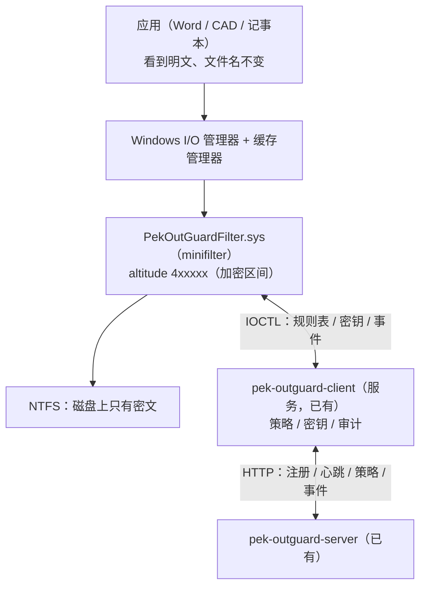

# minifilter 透明加密设计（全盘防泄漏形态）

> 产品定位已定：**公司电脑上凡命中规范的文件，在新增/编辑/保存时加密，用户无感、文件名不变、原目录不变。**
> 该形态只有内核 minifilter 能实现（用户态方案做不到，见 `决策记录.md` 第 18~20 节）。

## 1. 总体架构



**复用现状**：策略下发、密钥派生（MasterKey→PolicyKey）、审计上报、审批、面板全部沿用；
**新增**：内核驱动 + 驱动的控制通道 + 新文件格式。

## 2. 关键决策：文件格式换 XTS-AES-256（不再是 OGD1）

| | 现有 OGD1 容器 | **XTS-AES-256（透明加密用）** |
|---|---|---|
| 文件大小 | 变大（头 + 分块 tag + 尾） | **完全不变**（等长加密） |
| 随机写 | ❌ 分块 AAD 绑头部哈希，改一处要全量重写 | ✅ 按块独立，可原地随机写 |
| 应用兼容 | 只有我们能读 | **对应用完全透明**（CAD 的大文件随机访问也能跑） |
| 完整性校验 | ✅ 每块 GCM + 尾部 SHA-256 | ❌ 无认证（与 EFS/BitLocker 同级别） |

**结论**：
- **透明加密用 XTS**（大小不变、支持随机写，这是 DLP 的必然选择）；
- **OGD1 保留**用于"外发/导出/离线交换"（需要强完整性校验的场景）；
- 文件身份靠**规则判定 + NTFS 属性**，不靠文件头（EFS 也是这个思路：`FILE_ATTRIBUTE_ENCRYPTED`）。

> 必须写进文档的限制：XTS 不做逐块认证。**"大小不变"与"每块完整性校验"在数学上不可兼得**
> （tag 要占字节）。可选增强：把校验信息放 NTFS 备用数据流（ADS），第二版再考虑。

## 3. 驱动拦截点

| 回调 | 处理 |
|---|---|
| `IRP_MJ_CREATE` | 判定是否受控（规则表）；建立**每文件上下文**（StreamContext：文件 ID + 密钥）；决定"透明解密 / 直通密文 / 拒绝访问" |
| `IRP_MJ_READ` (Post) | 对读到的数据解密（缓存里的数据必须是明文，磁盘是密文） |
| `IRP_MJ_WRITE` (Pre) | 对要写的数据加密 |
| `IRP_MJ_SET_INFORMATION` | 文件截断（EOF）需要按块边界重新处理尾部 |
| `IRP_MJ_DIRECTORY_CONTROL` | **不用改**（XTS 大小不变，这是选它的最大好处） |
| `IRP_MJ_CLEANUP / CLOSE` | 释放文件上下文与密钥引用 |

**最难的两块（必须专门设计，不能想当然）**：
1. **缓存一致性与 paging I/O**：应用读写走缓存，缓存里必须是明文、刷盘时必须是密文。
   paging write 在 DPC/无用户态上下文里发生，**不能发消息给用户态** → 加解密必须在驱动内完成。
2. **内存映射（mmap）**：CAD/大文件常用，同样落在 paging I/O 路径上。

## 4. 密钥管理

```
服务端 MasterKey ──HKDF──> PolicyKey（已有）
                              │
                              ▼ 服务启动/策略更新时 IOCTL 下发
                     驱动非分页池（可尽量锁定）
                              │ 每文件派生
                              ▼
                     FileKey = HKDF(PolicyKey, 文件ID)
```

- 驱动**不落盘**保存任何密钥；服务重启后重新下发；
- 文件 ID 首次加密时生成（32 字节随机），存在文件 ADS 或侧表（待 M1 验证选型）；
- 卸载/停服时清理密钥；提供 `driver key purge` 命令。

## 5. 谁能看到明文（访问策略）

| 场景 | 行为 |
|---|---|
| 授权用户 + 本机会话内进程 | **透明解密**（这是"无感"的本质） |
| 我们的服务进程（备份/审计/导出） | 允许明文（受签名与路径双重校验） |
| 杀软 / 索引 / 备份软件 | 直通密文（避免把密文当病毒，也避免明文外泄） |
| 非授权用户 / 网络共享访问 / 远程 | 拒绝（返回密文或直接失败） |
| 驱动自身故障 | **数据优先**：宁可返回密文/报错，绝不写坏明文到磁盘 |

## 6. 与现有服务的通信（IOCTL 控制通道）

| 方向 | 消息 | 说明 |
|---|---|---|
| 服务 → 驱动 | `SET_RULES` | 受控路径前缀、扩展名表、排除项（增量更新，带版本号） |
| 服务 → 驱动 | `SET_KEY` | PolicyKey + 版本 |
| 服务 → 驱动 | `SET_POLICY` | 授权用户 SID 表、进程白名单/黑名单 |
| 驱动 → 服务 | `EVENT` | 加密/解密/拒绝/异常（异步队列，批量上报，复用现有审计） |

## 7. 性能预算（必须实测）

| 指标 | 目标 |
|---|---|
| 单次小文件（64 KB）读写额外延迟 | < 1 ms |
| 大文件顺序读写吞吐 | ≥ 200 MB/s（XTS + BCrypt 硬件加速应可达 GB/s 级） |
| 常驻内存（驱动） | < 8 MB |
| 空闲 CPU | 0%（无轮询） |

## 8. 最大风险（这些必须先解决才动手写业务逻辑）

| # | 风险 | 应对 |
|---|---|---|
| R1 | **蓝屏**：驱动 bug = 系统崩溃 | 专用测试机 + 系统快照；先写"只记日志不加密"版本跑一周 |
| R2 | **数据损坏**：写错 = 文件废 | 先写后提交、失败回滚；提供"驱动异常时批量解密导出"工具；关键路径加自校验 |
| R3 | **与已有加密驱动冲突** | 本机已有 `tbprotect`(404001)、`BzProtect`(289417)；安装时检测并提示，altitude 需避开 |
| R4 | **签名成本/周期** | EV 证书（约 ¥3000~5000/年）+ 微软 attestation 签名；开发期用 testsigning |
| R5 | **Windows 版本跟进** | 每次功能更新要回归；驱动兼容性矩阵需长期维护 |

## 9. 里程碑

| 阶段 | 内容 | 预估 |
|---|---|---|
| M0 | 环境（VS+WDK+testsigning）→ **最小驱动只记日志、不加密** | 3~5 天 |
| M1 | IOCTL 控制通道 + 规则表 + 每文件上下文（仍不加密） | 1 周 |
| M2 | XTS 加解密 + 密钥下发 + 读写正确性（先支持顺序 I/O） | 2 周 |
| M3 | 缓存/paging/mmap/截断/重命名边界 + Office、CAD、记事本实测 | 2 周 |
| M4 | 规则下发、审计上报、进程策略、与已有 DLP 共存 | 1~2 周 |
| M5 | 签名（EV+attestation）、安装包、卸载与批量解密导出 | 1~2 周 |

> 从 M0 到可交付约 **2~3 个月**（单人全职，顺利情况）。签名与硬件证书采购要提前启动，否则会卡在最后一步。

## 10. 与现有代码的衔接

| 现有模块 | 处理 |
|---|---|
| `core/container.rs`（OGD1） | 保留，用于外发/导出 |
| `core/crypto.rs` | 保留；新增 XTS 需要的 tweak/文件 ID 派生 |
| `core/rules.rs` | **直接复用**（规则判定逻辑一致，只是执行者从用户态变驱动） |
| `core/protocol.rs`、服务端策略/审计/审批 | 全部复用 |
| `client/src/secure_area.rs`（ProjFS） | 驱动到位后可下线（作为"未装驱动机器"的降级形态保留亦可） |
| `client/src/watch.rs` + `ops.rs`（.ogd 原地加密） | 保留为用户态降级方案 |
