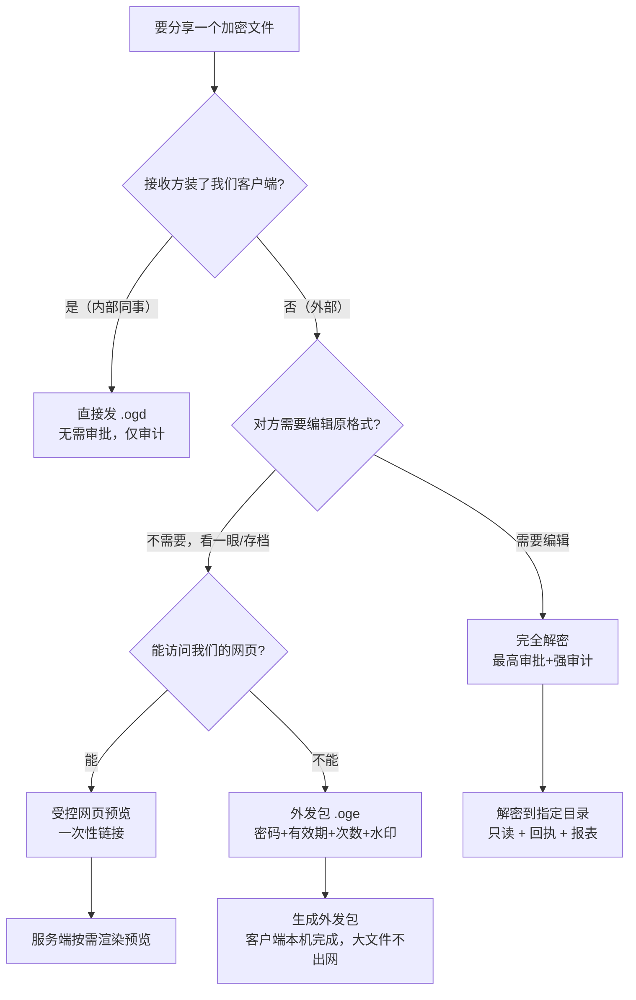
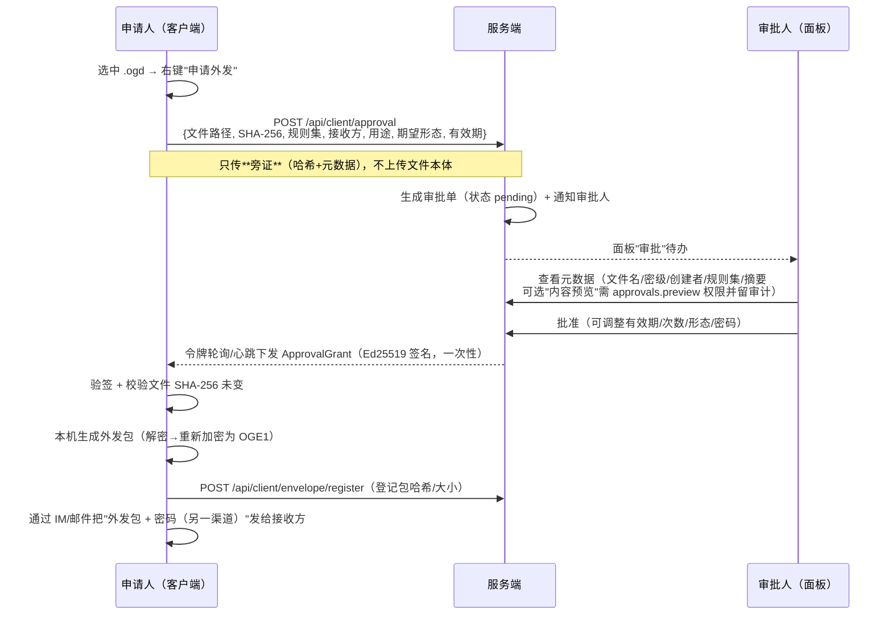

# 外发审批与外发包设计（M2）

> 对应需求 `FR-S-08`、`FR-C-16~18`；回答"要申请解密并分享出去"的完整链路。
> **核心原则：默认不解密，优先用外发包；解密是最后手段，且全程留痕。**

## 1. 先把"分享"分成四种，别一上来就解密

| 场景 | 做法 | 要审批吗 | 失控风险 |
|---|---|---|---|
| 发给**内部已装客户端**的同事 | 直接发 `.ogd`（对方有策略密钥，双击即开） | ❌ 不需要 | 无 |
| 发给**外部**（客户/供应商） | 生成**外发包** `.oge`（有效期 + 次数 + 密码 + 水印） | ✅ 需要 | 低–中 |
| 必须给**可编辑原格式** | **完全解密**到指定目录 | ✅ 最高审批 | **高：一旦解密即失控** |
| 只需对方**看一眼** | 受控网页预览（一次性链接，不落盘） | ✅ 需要 | 最低 |

> **最常见的误解**：给同事分享也要解密 —— **不需要**。同企业装了客户端的电脑之间直接传 `.ogd` 即可，对方用本机策略密钥打开。这也是"一个规则集绑多个部门"的价值所在。

## 2. 决策树



## 3. 审批流程（文件不出网）



**关键设计**：外发包在**客户端本机生成**，服务端只签发授权令牌。
理由：① 客户端本来就有解密能力，服务端再解密没有额外安全收益；② 图纸/CAD 几百 MB，上传服务端不现实；③ 服务端职责收敛为"授权 + 审计 + 吊销"。

### 3.1 客户端入口（菜单）

**托盘菜单**（右键托盘图标）：

```
OutGuard 数据防护
├─ 状态：已连接 · 策略 v12 · 最后同步 10:32
├─ ──────────────────
├─ 我的申请…            → 申请列表（待审批 / 已通过 / 已拒绝 / 已过期）
├─ 申请解密…            → 选文件 → 填写表单 → 提交
├─ 申请外发…            → 选文件 → 填写表单 → 提交
├─ ──────────────────
├─ 查看日志…
└─ 关于
```

> 托盘菜单**不提供**"暂停保护"；普通用户没有"退出"项（退出/卸载需服务端令牌，见 FR-C-03）。

**文件操作窗口**（双击 `.ogd`，或右键 → "发送到 OutGuard"）：

```
OutGuard — 加密文件
合同.docx · 内部 · 研发文档 v3
创建者 zhangsan · 2026-10-20

[ 安全打开 ]  [ 申请解密 ]  [ 申请外发 ]  [ 查看信息 ]
```

- **安全打开**：解密到受控临时目录 → 默认程序打开 → 关闭清理（FR-C-08）
- **申请解密**：提交审批，通过后解密到本机指定目录（完全解密，最高审批）
- **申请外发**：提交审批，通过后本机生成外发包 `.oge`
- **查看信息**：显示容器明文头（公司/密级/规则集/创建者）

**申请表单**（解密/外发共用）：

| 字段 | 必填 | 说明 |
|---|---|---|
| 文件 | ✅ | 已选文件可追加（显示哈希前 8 位，对得上审批单） |
| 用途/原因 | ✅ | 审批人的判断依据 |
| 接收方 | 外发必填 | 公司/联系人/邮箱（写入水印与审计） |
| 期望形态 | ✅ | 外发包 `.oge` / 受控网页预览 / 完全解密 |
| 有效期 | 外发必填 | 1 / 3 / 7 / 30 天 |
| 打开次数 | 外发可选 | 默认 3 次 |

**结果反馈**：

- 提交成功 → 显示审批单号，托盘"我的申请"出现待办；
- 审批通过 → 托盘通知 + "立即执行"按钮（生成外发包 / 执行解密）；
- 被拒绝 → 通知 + 拒绝原因；
- 离线 → 提示"需联网提交申请"（离线不产生审批单）。

**技术实现**：M1 用"双击 `.ogd` 打开客户端操作窗口 + 托盘菜单"，**不依赖 Shell COM 扩展**（Win10 的 `IContextMenu` 与 Win11 新菜单机制不同，COM 扩展成本高且易被安全软件拦截）；Shell 右键菜单作为 M2 可选增强。

## 4. 授权令牌 `ApprovalGrant`（服务端 → 客户端）
```json
{
  "approvalId": "AP-2026-0001",
  "clientId": "c-01",
  "machineId": "…",
  "files": [{ "path": "D:\\Work\\合同.ogd", "sha256": "…" }],
  "form": "envelope",            // envelope | web_preview | plain
  "expireAt": "2026-11-02T00:00:00+08:00",
  "maxOpens": 3,
  "passwordSalt": "…",           // 有密码时
  "nonce": "…",
  "signature": "base64(Ed25519)"
}
```

- 客户端内置**服务端公钥**验签；服务端记录 `nonce` 防重放，令牌默认 **24 小时**内有效（只给"生成外发包"的时间窗）。
- 令牌与文件 SHA-256 绑定：换文件即失效。
- 令牌一次性：生成成功后服务端标记已用。

## 5. 外发包格式 `OGE1`

```
偏移        长度        内容
0           4          Magic "OGE1"
4           2          formatVersion = 1
6           2          flags
8           4          headerLen
12          H          EnvelopeHeader JSON（明文：公司提示/接收方/有效期/水印文本/令牌签名）
12+H        4          wrappedKeyLen
16+H        K          wrappedKey: AES-256-GCM(DEK)，KEK = PBKDF2-SHA256(打开密码, salt, 600000)
16+H+K      8          payloadLen
…           N          payload: OGD1 容器（用外发 DEK 重新加密的原文件）
末尾        32         SHA-256
```

- payload 仍是 OGD1 容器 → 复用现有 core 实现，只是换了一把"外发密钥"。

### 5.1 密码策略（三档，按场景选）

| 档位 | 密码 | 对方体验 | DEK 如何保护 | 防得住什么 |
|---|---|---|---|---|
| **无密码（默认）** | 不需要 | 双击即看 | 查看器内置固定 KEK 包裹 DEK | 防"直接用 Office/看图软件打开"、防随手转发（有效期/次数）、可追溯（水印/回执）；**防不住逆向查看器** |
| **固定密码** | 审批人设一个（如与老客户约定） | 输一次 | PBKDF2-SHA256(密码, salt, 60 万次) 派生 KEK 包裹 DEK | 防"包被转发后别人打开" |
| **随机密码（敏感件推荐）** | 系统生成 8–12 位（如 `A7K9-2M4X`），审批人可见 | 输一次 | 同上 | 同上，且密码一次性 |
| （可选）绑定接收方 | 手机号后 4 位 / 工号 | 输一次 | 同上（弱口令） | 免传递，但强度低 |

**密码传递规则**：包与密码**必须分渠道**（包走邮件/IM，密码走电话/短信/另一 IM），否则等于没设。

### 5.2 无密码外发包到底保护什么（如实说明）

- **是密文**：不解包拿不到原始 docx/pdf；
- **有行为管控**：有效期、打开次数、屏幕/文档水印、打开回执（联网校验）；
- **不是密码学保护**：查看器内置的 KEK 可被逆向提取，技术型对手能绕过。

三档建议：**普通商务往来 → 无密码**（够用且体验好）；**敏感件 → 随机密码**；**必须可控 → 受控网页预览**（不落盘，页面不可下载）。

## 6. 查看器（OutGuard Viewer）

- **单 exe、免安装**（Rust 编译，约 3–5 MB），无需管理员权限。
- 支持 **PDF / 图片 / 纯文本**的内置安全预览（解密在内存，不落盘）。
- **Office/CAD 等原格式**：生成外发包时先转 PDF（客户端调用本机 Office/WPS COM；转换失败则提示"该格式请申请 PDF 外发"）。
- 打开流程：验签 header → 校验有效期 → 校验打开次数 → 输入密码 → 解密 → 渲染/预览。
- 打开次数与首次打开时间记录在 `%ProgramData%\OutGuardViewer\`，联网时上报回执。

## 7. 吊销与打开回执

| 模式 | 机制 | 适用 |
|---|---|---|
| 宽松（默认） | 本地校验有效期/次数；联网时上报回执并检查吊销列表 | 无外网环境 |
| 强管控 | **每次打开必须联网校验**（服务端可实时拒绝） | 对方能上网 |

打开回执包含：审批单号、接收方、机器码、IP、时间、第几次打开、是否成功。
服务端"审批"页可直接吊销：吊销后下次校验即拒绝。

## 8. 水印

- **屏幕水印**：查看器渲染时动态叠加"接收方 + 时间 + 禁止转发"。
- **文档水印**：转 PDF 时叠加到页眉/页脚/平铺（接收方、有效期、审批单号）。
- **如实说明**：截图、拍照无法阻止；水印的作用是**追溯与威慑**，不是阻断。

## 9. 完全解密（明文外发，最后手段）

- 需要**超级管理员**审批 + 二次确认，审批单强制填写用途与接收方。
- 解密到指定目录，文件设置只读，生成"解密回执"（含文件哈希）。
- 审计强标记（`plaintext_export`），进入月度报表；支持按人/部门统计。
- 更安全的替代：**解密但转为带水印 PDF**（不可编辑，可追溯）——多数"必须给原格式"的需求其实是"必须给一份能用的文件"。

## 10. 安全边界（如实告知客户）

1. 明文一旦离开受控体系即**不可控**：对方可任意转发、截图、二次编辑。
2. 外发包的强度来自"**密码渠道分离 + 有效期 + 次数 + 水印 + 打开回执**"的组合，而非某个算法。
3. 查看器是本地程序，**可被逆向绕过本地校验**；要强约束必须开启"每次打开联网校验"。
4. 服务端默认**不解密内容**，只做授权与审计；"内容预览"属独立权限且每次留痕。
5. **无密码外发包 ≠ 加密保护**：它只防"随手打开/随手转发"，防不住逆向查看器；**带密码的外发包才是密码学保护**（PBKDF2 60 万次 + AES-256-GCM）。

## 11. 数据表与接口

| 表 | 关键列 |
|---|---|
| `Og_Approval` | Id、ClientId、User、Files(JSON：路径+哈希)、Reason、Receiver、Form、ValidHours、MaxOpens、Status、Approver、DecidedAt、RevokedAt |
| `Og_Envelope` | ApprovalId、EnvelopeHash、Size、CreatedAt、DownloadUrl、Revoked |
| `Og_EnvelopeOpen` | EnvelopeId、MachineId、Ip、OpenedAt、Success、Detail |

| 接口 | 说明 |
|---|---|
| `POST /api/client/approval` | 提交申请（含文件哈希） |
| `GET /api/client/approval/{id}` | 查询状态与令牌 |
| `POST /api/client/envelope/register` | 登记生成的外发包（哈希/大小） |
| `POST /api/envelope/open` | 查看器打开回执 + 吊销校验（公开、限流） |

## 12. 分期与验收

- **M1**：内部转发（`.ogd` 直传）已天然支持，无需审批。
- **M2**：申请 → 审批 → 令牌 → 本机生成外发包 → 查看器 → 吊销 → 回执全链路。

验收用例：

1. 内部同事直传 `.ogd` → 双击可开，无审批单；
2. **完全解密**审批后 → 明文可直接用任意程序打开（无需查看器/密码）；
3. 外部客户收到 `.oge` → 用查看器直接打开（默认无密码）；若审批时设了密码则需输入；
4. 超过有效期 / 超过打开次数 → 拒绝并提示；
5. 审批人吊销 → 联网校验立即拒绝；
6. 篡改外发包任一字节 → 打开失败（AES-GCM + SHA-256）；
7. "完全解密"审批后 → 生成只读明文 + `plaintext_export` 审计 + 月度报表可见。
