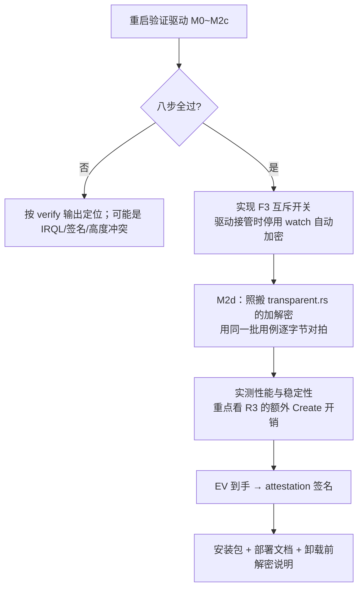

# 全量审计报告（第 23 轮 · 阶段性收口）

> 用户要求：「做一次全量审计吧，没有问题了就等后面相应的资料到了再继续。」
>
> 这份报告不是把前几轮结论抄一遍，而是**重新实测 + 重新排查**，
> 目的是回答一个问题：**现在能不能安全地停下来等资料？**

---

## 1. 审计方法与范围

| 项 | 内容 |
|---|---|
| 时间 | 2026-10-27 |
| 范围 | 全仓库：`core/`、`client/`、`server/`、`driver/`、全部文档 |
| 方法 | ①**重新跑**构建/测试/clippy 基线（不引用旧结论）②全仓扫描危险模式（panic、吞异常、密钥泄漏）③架构一致性检查（多方案是否互斥）④全部历史审计报告的遗留风险**去重合并** |
| 未覆盖 | 驱动运行时行为（无法加载）、真实多终端并发压测、客户实际环境兼容性 |

---

## 2. 基线实测（本轮重新跑，非引用）

```
git 工作区                    干净（HEAD = b4f355b）
cargo test --workspace        = 140 passed（client 66 / core 69 / 集成 3+2），1 项性能基准 ignored
cargo clippy --workspace --all-targets -D warnings = 0 告警
driver/build.ps1              = 编译 + 自动签名通过 → 30,600 字节
C_ASSERT(sizeof(OUG_STATS) == 664) / (sizeof(OUG_RULES) == 9356) = 通过（Rust 侧同值断言通过）
driver/verify.ps1             = PowerShell 语法检查通过
```

代码规模：

| 模块 | 文件 | 行数 |
|---|---|---|
| `core/` | 10 个 .rs | 2,988 |
| `client/` | 19 个 .rs | 7,890 |
| `server/` | 8 个 .rs | 1,807 |
| `driver/` | 1 个 .c | 932 |
| **合计** | 38 | **约 13,600 行** |

---

## 3. 实质发现（本轮新查出的问题）

### F1（中危）状态保存失败被静默忽略 · **已修复**

| 位置 | 后果 |
|---|---|
| `client/src/main.rs:591` | 心跳成功后保存 `last_heartbeat` 失败 → 下次启动看到的是旧值，**运维会误判"心跳一直没成功"** |
| `client/src/runtime.rs:1017` | 自动加密后保存**待上报事件队列**失败 → **加密事件可能永久丢失 → 审计不完整** |

第二处比第一处严重：审计链断了，等于"文件被加密了但系统里查不到记录"。
对 DLP 产品而言，这比功能缺失更麻烦——出事后无法追溯。

**已改为 `warn!` 并写明后果**，不再吞掉。

### F2（低危）ProjFS instance-id 写入失败被静默忽略 · **已修复**

`client/src/secure_area.rs:977`：写失败会让下次启动生成新 GUID，与已存在的占位符不匹配 → 安全区起不来。

影响面小（ProjFS 已判定不可行、`SecureAreas` 默认空 → 默认不启用），但同样已改为 `warn!`。

### F3（中危，架构风险，**未解决**）两套加密方案并存，没有互斥开关

这是本轮**最重要的发现**：

| 方案 | 当前状态 | 加密方式 |
|---|---|---|
| 用户态容器（`.ogd`） | **当前实际形态**，由 `watch.rs` 监控 + `ops::encrypt_file` 执行 | 把文件转成 `.ogd` 容器（改文件名） |
| 内核 minifilter 透明加密 | M2a~M2c 已就绪，**M2d（实际加解密）未实现** | 文件原地 XTS 等长加密（名字不变） |

**如果将来 M2d 上线而 `watch.rs` 仍开着**，同一个文件会被**先被驱动 XTS 加密、再被用户态包一层 OGD1** → 双重加密 → 应用读到乱码 → 用户看到"文件损坏"。

目前 M2d 未实现所以尚未暴露，但**必须在 M2d 之前设计互斥**。

**建议方案**：驱动确认可用（`driver status` 的 `KeyState == 1` 且规则版本一致）时，
`watch` 的自动加密**自动停用**并在日志与面板明确提示"透明加密已接管"。
这条已作为 **M2d 的准入条件**写入遗留清单。

---

## 4. 已核查、确认无问题的项（附证据）

| # | 检查项 | 结论 | 证据 |
|---|---|---|---|
| 1 | **非测试代码中的 panic** | **零** | 全仓扫描 `.unwrap()` / `.expect()`，非 `#[cfg(test)]` 区域 0 命中 |
| 2 | **密钥是否进日志** | 否 | 全仓扫描 `warn!/info!/debug!/error!/println!` 中带 key/token/secret/password 的行，唯一命中是用法提示文本 `driver key --key-hex <...>` |
| 3 | **`let _ =` 是否都在吞错** | 27 处中 **24 处可接受** | 其余 24 处均为「错误路径上的临时文件清理」或「Linux 专属权限设置（Windows 上为 no-op）」；3 处真问题已修（F1/F2） |
| 4 | **自动加密默认行为** | **安全** | `EncryptOptions::default()` = `dry_run: true` → **默认只判定、不动文件** |
| 5 | **已判不可行的 ProjFS 是否默认关闭** | **是** | `ClientSection` 的 `secure_areas` 默认 `Vec::new()`，空列表不启动 |
| 6 | **`transparent.rs` 是否有调用方** | **无** | 全仓扫描 `transparent::` / `TransparentFile`，除自身与测试外 0 命中 → 与第 20 轮报告一致，不影响现网行为 |
| 7 | **驱动控制面权限** | 已限制 | `IoCreateDeviceSecure` + SDDL `D:P(A;;GA;;;SY)(A;;GA;;;BA)`（第 18 轮 S1 修复） |
| 8 | **驱动是否信任磁盘数据** | 否 | 魔数 + 版本 + **SHA-256 校验和**三重校验，任一不符即拒绝采信（第 19 轮 R1 修复） |
| 9 | **算法两端一致性** | 已验证 | Rust `sha2` 与 CNG/BCrypt 对同一 32 字节样本输出相同校验和 `6463c5099f757a10`，并锁死为黄金样本测试 |
| 10 | **XTS 密文兼容性** | 已验证 | 8 路批量优化与逐块参考实现**逐字节对拍**通过；与 Windows CNG 参考向量一致 |
| 11 | **透明加密长度不变量** | 有测试 | 13 项测试断言「磁盘长度 == 明文长度」，含 0/1/15/16/17/31/32/33/100/4096/4097 |
| 12 | **截断安全** | 有测试 | `truncate_to_non_block_boundary_keeps_plaintext_readable` 守住最容易写错的边界 |
| 13 | **救援路径完整性** | 可用 | `rescue info/encrypt/decrypt/verify/scan` 均实测通过；伪造标记会被拒绝并给出原因 |
| 14 | **文档一致性** | 本轮已修 | README 已重写（第 22 轮）；技术路线表、里程碑状态、安全边界与代码一致 |
| 15 | **本轮是否引入写路径** | 仅 F1/F2 修复涉及 | 只增加日志，**未新增任何写用户文件的代码** |

---

## 5. 遗留风险总表（全部历史审计去重合并）

按严重度排序。**已解决的不再列出，未解决的不许写成已解决。**

| # | 风险 | 等级 | 阻塞什么 | 靠什么解决 |
|---|---|---|---|---|
| **R4** | **驱动 M0~M2c 从未实际加载运行** | **高** | 整个透明加密路线是否成立 | **一次重启** + `driver\verify.ps1` |
| **A3** | 驱动侧 Read/Write 实际加解密未实现 | **高（功能缺口）** | 产品的核心卖点 | 参照实现已就绪，待 R4 解决后搬入 |
| **R5** | 无 EV 代码签名 | **高** | 能否装到客户/正式机器 | EV 采购 2~3 周（已启动路径） |
| **F3** | 两套加密方案无互斥开关 | **中** | M2d 上线即会双重加密 | M2d 准入条件，须先实现互斥 |
| A1 | 无密钥校验和挡不住有写权限者重算 | 中 | 数据**可用性**（非机密性） | 侧表已实现，**"选优逻辑"未接入** |
| R3 | 每命中 Create 多一次 Create+Read+Close | 中 | 性能 | 待 R4 后实测，必要时加 stream handle 缓存 |
| A2 | 每次探测一次 BCrypt 句柄创建（1~3μs） | 低 | 性能 | 并入 R3 缓存方案 |
| A4 | 侧表与 ADS 无定期一致性巡检 | 低 | 发现篡改的及时性 | M3 加低频巡检（须变化驱动） |
| R6 | 客户端服务必须以 LocalSystem 运行 | 低 | 部署 | 写进部署文档 |

**统计**：高 3 项 / 中 3 项 / 低 3 项。**其中 2 项（R4、R5）100% 依赖外部条件，1 项（A3）依赖 R4。**

---

## 6. 结论：现在能不能干净地停下来？

### 6.1 判断：**能，且停下来是安全的**

理由（三条硬保证）：

1. **没有未受控的写路径**
   - 用户态容器加密：`dry_run: true` 默认不动文件；
   - ProjFS 安全区：`SecureAreas` 默认空，不启动；
   - 驱动：M0~M2c **零写路径**（只读 ADS + 只计数）；
   - `transparent.rs`：无调用方。
   → **当前代码跑起来不会动用户任何一个文件。**

2. **构建与测试是绿的**
   140 项测试、clippy 零告警、驱动可编译可签名。任何时候回来都能从干净状态接手。

3. **阻塞项全部在外部**
   剩下的三件要事（加载验证、EV 证书、M2d 实现）里，前两件完全不在代码侧。

### 6.2 当前可交付状态（如实描述）

| 能力 | 状态 |
|---|---|
| 服务端：终端准入 / 策略下发 / 密钥托管 / 审计 / 面板 | ✅ **可用** |
| 客户端：注册 / 心跳 / 策略同步 / 离线宽限 | ✅ **可用** |
| 文件加密：用户态容器（`.ogd`）+ 受控打开 + 自动加密 | ✅ **可用**（实测通过） |
| 救援：离线解密 / 批量体检 | ✅ **可用**（实测通过） |
| 透明加密（原地、名字不变） | ⚠️ **未完成**（驱动未验证 + M2d 未实现） |
| 正式安装到 Secure Boot 机器 | ⚠️ **未就绪**（等 EV） |

**一句话**：现在的产品形态是「**可用的用户态 DLP**」，透明加密是**在研的下一代形态**，尚不能对外宣称。

---

## 7. 恢复条件与恢复清单

### 7.1 等什么

| 资料/条件 | 到了之后第一件事 |
|---|---|
| **能重启（testsigning）** | 跑 `driver\verify.ps1`（八步全自动，含反证与篡改检测）→ 结果决定 M2d 是否继续 |
| **EV 证书 + 硬件令牌** | 注册 Partner Center → 绑定提交证书 → 首次 attestation 签名 → 在 Secure Boot 开启的干净机器上验证加载 |

### 7.2 恢复后的推荐顺序



**注意顺序**：F3 互斥必须在 M2d **之前**做完，否则 M2d 一上线就会双重加密。

---

## 8. 本轮审计结论

**审计基线：全绿。实质发现 3 项，已修 2 项（F1/F2），1 项（F3）转入 M2d 准入条件。**

最有价值的不是"发现问题"，而是第 3 节的 F3：**两套加密方案并存而无互斥**。
它现在完全无害（M2d 未实现），但一旦有人急着把 M2d 写完就直接上线，
用户会遇到"文件突然打不开"——而且极难定位，因为每个组件单独看都是对的。

这类问题只有"站在整个系统之上看"才能发现，是**全量审计相对于单轮审计的价值所在**。

**可以安全暂停。等资料到了按第 7.2 节的顺序恢复。**
