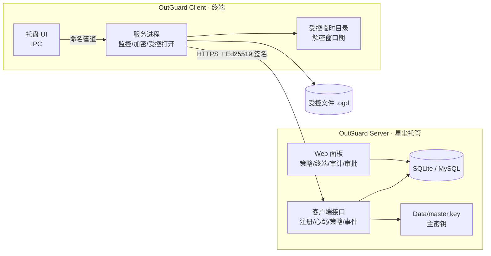
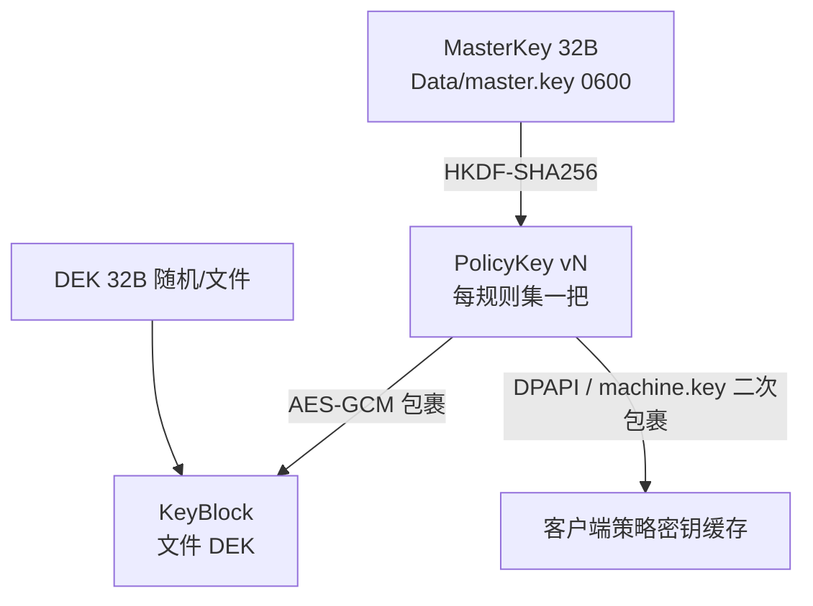
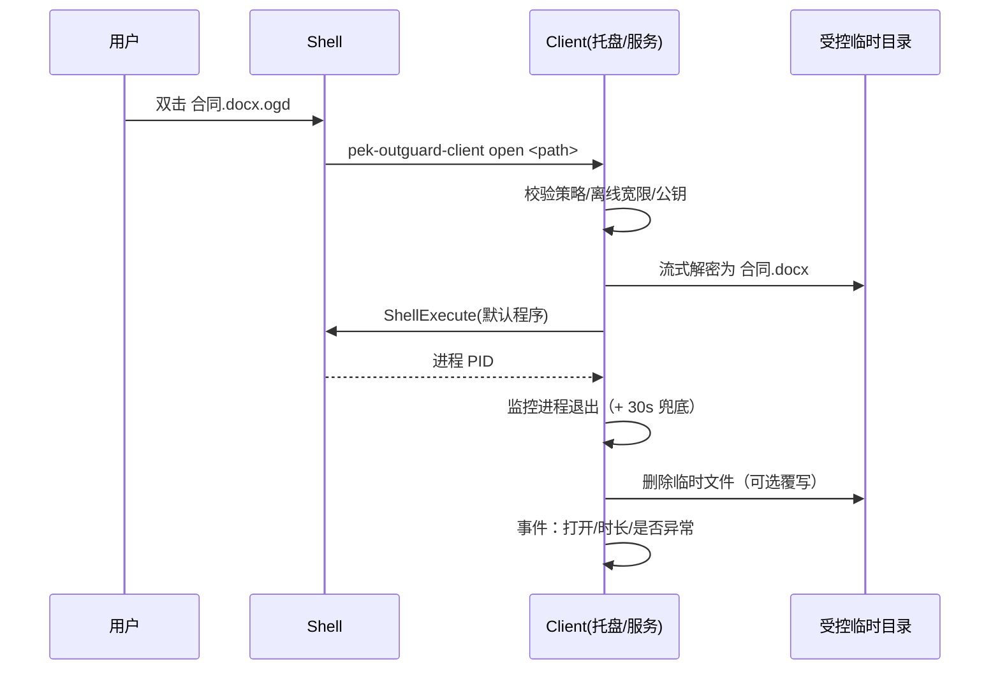

# Pek.ROutGuard 架构设计

> 版本：v0.1（2026-10-26）· 对应需求 `docs/需求说明书.md` v0.1
> 原则：**复用生态先行**（dhrust / Pek.RCode / Pek.RAdmin / Pek.RWaf），只写生态没有的 DLP 专有能力。

## 1. 总体拓扑



- **Server 单机部署**（与 Pek.RAgent / Pek.RPanlServer 生态一致），星尘托管影子模式运行。
- **Client 每终端一套**，Windows 服务 + 托盘。
- 两者只通过 HTTPS API 交互：客户端主动外联（无需服务端反连），适合内网/跨网段。

## 2. 代码结构（Cargo workspace）

```
core/     pek-outguard-core      容器格式 / 规则引擎 / 协议模型 / 密钥派生（双端共享，纯逻辑无 IO 副作用）
server/   pek-outguard-server    管理端 bin
client/   pek-outguard-client    终端 bin
```

**为什么 core 必须独立**：规则匹配与容器格式必须**双端同一份实现**，否则"服务端预览的判定结果"与"客户端实际执行"会漂移（Pek.RCode 的教训：消费方各自复制实现）。

## 3. 加密容器格式（v1）

`.ogd` 为唯一对外格式，**未装客户端只能看到明文头 + 密文**。

```
偏移        长度        内容
0           4          Magic  "OGD1"
4           2          formatVersion = 1
6           2          flags（bit0=头部是否加密，首版 0）
8           4          headerLen (u32 LE，≤ 64 KiB)
12          H          Header JSON（UTF-8，明文）
12+H        4          keyBlockLen (u32 LE)
16+H        K          KeyBlock：nonce(12) || AES-256-GCM(DEK)，AAD = SHA-256(Header JSON)
16+H+K      4          chunkSize (u32 LE，默认 1 MiB，上限 16 MiB)
20+H+K      8          noncePrefix（随机；分块 nonce = prefix(8) || 块序号 LE(4)）
28+H+K      4+N        [分块]：u32 LE 密文长度 + AES-256-GCM 密文（tag 附尾；每块 AAD 同上）
…           4          END 标记（u32 LE = 0；合法密文块长度 ≥ 16，故无歧义）
末尾        32         SHA-256（覆盖 END 之前的全部字节）
```

> **KeyBlock 必须前置**：解密要先拿到 DEK 才能流式解密；若放尾部就得把整份密文读完再回头解，4 GB 文件会多一次全量 IO。
> 明文头 + 明文 KeyBlock 都不含密钥材料，未装客户端用记事本即可看到公司提示语。

**Header JSON**（明文，满足"未装客户端也能看到防泄密提示"）：

```json
{
  "company": "XX有限公司",
  "notice": "本文件已加密，仅限安装 OutGuard 客户端的授权电脑打开。如需外发请联系信息安全部门。",
  "classification": "内部",
  "policyId": "…", "policyVersion": 12, "ruleId": "…",
  "creator": "zhangsan", "clientId": "…",
  "createdAt": "2026-10-26T10:00:00+08:00",
  "originalName": "合同.docx", "originalSize": 123456,
  "plainSha256": "…"
}
```

设计要点：
- **AAD = SHA-256(Header JSON)**：头部被篡改（改公司名/密级）会导致解密失败。
- 分块独立 GCM tag：支持流式加解密 + 断点续作，单块损坏不毁全文件。
- `originalName` 让客户端打开时按原名解密，避免 Office 关联失效。
- 明文头**不含任何密钥材料**，仅元数据 + 提示语。

## 4. 密钥体系



| 密钥 | 生成 | 存放 | 轮换 |
|---|---|---|---|
| MasterKey | Server 首启随机 32B | `Data/master.key`（0600，不入库不出网） | 支持备份/更换（旧密钥保留为 `master.key.v{n}`） |
| PolicyKey | `HKDF(MasterKey, "outguard/policy/{id}/v{n}")` 派生 | 不存明文；下发时用客户端公钥或 TLS 通道 + 本地包裹 | 提升 `key_version`，历史版本仍可派生 → 旧文件可解 |
| DEK | 每文件随机 | 仅存在于 KeyBlock（KEK 包裹） | 随文件 |
| 设备密钥对 | 客户端注册时生成 Ed25519 | 私钥客户端本地（DPAPI 保护），公钥登记服务端 | 重装即换新 |
| 客户端本地密钥 | Windows DPAPI / Linux `Data/machine.key`(0600) | 本地 | 随系统 |

**离线可用**：客户端缓存"包裹后的 PolicyKey"，断网也能加解密；宽限期只影响**打开**（可配），不影响已加密数据的可用性。

## 5. 规则引擎（core::rules）

```rust
pub struct Rule {
    pub id: String,
    pub priority: i32,          // 数值大者优先
    pub action: Action,         // Encrypt | Plaintext | BlockWrite | Audit
    pub extensions: Vec<String>,// ["docx","xlsx","*"]，空=不限
    pub name_patterns: Vec<String>,
    pub path_prefixes: Vec<String>,
    pub process_names: Vec<String>, // ["winword.exe","wps.exe"]
    pub min_size: Option<u64>,
    pub max_size: Option<u64>,
}
```

判定顺序（**双端共用同一函数**）：

1. 系统/临时/缓存目录硬排除（内置）
2. 规则集绑定的 `exclude` 路径
3. 规则按 `priority` 降序、同级按声明顺序依次匹配
4. 都不命中 → 规则集 `default_action`（默认 `Plaintext`）
5. 结果 = `(action, matched_rule_id)`，写入容器头与审计

输入结构 `FileContext { path, size, process_name, user }`——服务端"规则预览"与客户端"实际执行"用同一输入模型。

## 6. 服务端模块

```
server/src/
  main.rs         CLI：run / install / uninstall / status / -RegisterAgent
  app.rs          装配：日志 → 配置 → 数据库 → 密钥 → 路由 → 监听
  db.rs           Pek.RCode store（Entity/Model.xml 生成）
  keys.rs         MasterKey 管理 + PolicyKey 派生 + 轮换
  policy.rs       规则集 CRUD / 绑定 / 版本推进 / 回执
  client_api.rs   /api/client/*（注册/心跳/策略/事件/审批/卸载令牌/升级）
  panel/          面板 API（复用 pek_radmin：用户/权限/审计）
  approvals.rs    外发审批
  upgrade.rs      客户端升级包（复用 dhrust::upgrade + patch）
  res/index.html  单文件面板（include_bytes!）
```

数据表（`Entity/Model.xml`）：

| 表 | 关键列 |
|---|---|
| `Og_Client` | ClientId、MachineId、Host、Os、Version、PolicyVersion、GroupId、Status、LastSeen、PubKey |
| `Og_Group` | Name、ParentId、Remark |
| `Og_ClientGroup` | ClientId、GroupId |
| `Og_PolicySet` | Name、Version、KeyVersion、DefaultAction、Enabled、CompanyInfo、Remark |
| `Og_PolicyRule` | PolicyId、Priority、Action、Conditions(JSON) |
| `Og_PolicyBinding` | PolicyId、TargetType(Group/Client/User)、TargetId、Priority |
| `Og_PolicyAck` | ClientId、PolicyId、Version、AckTime |
| `Og_ClientEvent` | ClientId、User、EventType、Path、RuleId、Detail、OccurredAt、ReceivedAt |
| `Og_Approval` | ClientId、User、Files、Reason、Receiver、ExpireAt、Status、Approver、DecidedAt |
| `Og_UninstallToken` | ClientId、Nonce、ExpireAt、Signature、Used |
| `Og_Setting` | Key、Value |

## 7. 客户端模块

```
client/src/
  main.rs        CLI：run / install / uninstall --token / status / open <file>
  service.rs     dhrust::service 注册与运行
  guard.rs       双进程互保 + 完整性自校验（60s）
  config.rs      Config/OutGuard.Client.toml（TomlConfig，服务端下发覆盖）
  enroll.rs      注册 + Ed25519 设备密钥（DPAPI）
  policy.rs      策略缓存（机器密钥包裹）+ 版本回执
  watcher.rs     notify crate（Windows ReadDirectoryChangesW / Linux inotify）+ 800ms 去抖
  engine.rs      调用 core::rules 判定
  crypto.rs      调用 core::container 流式加解密 + 原子替换 + 安全删除
  open.rs        受控打开：解密到 temp → ShellExecute → 进程退出 → 清理
  audit.rs       本地队列（SQLite/文件）+ 批量上报（5s / 200 条）+ 去重
  ipc.rs         命名管道（托盘 ↔ 服务）
```

**监控策略（性能红线）**：
- 只监控"规则可能命中的根路径"（由策略下发 `watch_roots`），不做全盘轮询。
- 事件去抖 800ms（Office 保存会连续产生多个写事件）；同一路径 2s 内只处理一次。
- 加密在**独立工作线程 + 有界队列**执行，不阻塞监控线程；大文件分块读写，内存占用 ≤ 8 MB。

**受控打开时序**：



## 8. 防退出设计（及边界）

| 层 | 手段 |
|---|---|
| 进程 | Windows 服务（LocalSystem）+ `SERVICE_CONFIG_FAILURE_ACTIONS` 自动重启 |
| 互保 | 独立 `guard` 进程（同 exe 不同参数）5s 检查服务，缺失则拉起；服务反向守护 guard |
| 权限 | 服务 ACL 限制 `SERVICE_STOP` 给 SYSTEM/Administrators；程序与配置目录 ACL 禁普通用户写 |
| 卸载 | `uninstall` 必须带服务端签发的 Ed25519 令牌（machineId + 过期时间 + nonce），客户端内置公钥验签；无令牌拒绝并上报 |
| 完整性 | 核心文件 SHA-256 清单内嵌；不匹配 → 上报 + 从备份恢复 |
| 升级 | 覆盖替换（影子模式），不需要用户停服 |

**边界（必须写进交付文档）**：本地管理员可用内核工具/PE 修改/重装系统绕过；本设计的目标是"合规管控 + 防普通用户误操作"，不是"对抗恶意管理员"。

## 9. 客户端接口（HTTPS + 签名）

所有请求头：

```
X-OG-Client: <clientId>
X-OG-Timestamp: <unix秒>
X-OG-Nonce: <随机16字节hex>
X-OG-Signature: base64(Ed25519(sign(method\npath\ntimestamp\nnonce\nsha256(body))))
```

| 方法 | 路径 | 说明 |
|---|---|---|
| POST | `/api/client/register` | 机器码 + 主机信息 + 公钥 + 注册码 → clientId / token / 状态 |
| POST | `/api/client/heartbeat` | 策略版本 + 健康状态 + **仅变化项** → 期望版本 / 指令 |
| GET | `/api/client/policy?version=N` | 拉取规则集 + 包裹后的 PolicyKey（304 语义：版本未变返回空） |
| POST | `/api/client/events` | 批量事件（≤200）→ accepted / duplicated |
| POST | `/api/client/approval` | 外发申请 |
| GET | `/api/client/approval/{id}` | 查询审批结果 |
| GET | `/api/client/upgrade?version=` | 升级包地址 + SHA-256 + 签名 |

服务端：`nonce` 5 分钟内存表防重放；`timestamp` 偏移 > 300s 拒绝；未注册客户端只能访问 `register`。

## 10. 部署与运维

- **Server**：`pek-outguard-server -RegisterAgent` 注册到星尘（Mode=11 影子模式、ReloadOnChange=true），覆盖程序文件即自动升级；`Config/OutGuard.toml` 热重载；`Data/master.key` 首次启动生成并提示备份。
- **WAF**：`pek_rwaf::admin_api()`；`/api/client` 前缀 `set_forced_skip_bot_prefixes`（客户端 UA `OutGuardClient/x.y` 会被误判为扫描器），攻击特征检测仍生效；**写 WAF 测试时 `loopback_bypass=false`**。
- **HTTPS**：无域名直连场景用自签叶子证书（`CA:FALSE` + SAN 全本机 IPv4）；有域名走反代 + 公共证书。
- **Client**：`msiexec /i OutGuardClient.msi /qn SERVER=https://host:5600 ENROLLCODE=xxx`（安装即注册）。
- **审计**：服务端事件表按月分表可选（Pek.RCode `timeShard`）；客户端本地队列上限 5 万条，超出丢弃最旧并记一条"队列溢出"事件。

## 11. 复用清单（新增能力必须在此登记理由）

| 能力 | 复用来源 |
|---|---|
| 日志 / 配置 / 原子替换 | `dhrust::logs` / `dhrust::config::TomlConfig` / `dhrust::io::safe_replace_file` |
| HTTP 服务 / 路由 / 静态资源 | `dhrust::net::http` + `router` + `static_files` |
| 面板鉴权 / 登录限流 | `dhrust::net::panel_auth` + `login_guard` |
| WAF | `pek_rwaf` |
| 服务化 / 星尘 / 升级 / 补丁 | `dhrust::service` / `staragent` / `upgrade` / `patch` |
| ORM / 数据库 / 备份 | `pek_rcode`（`database` + `store` + `db_admin`） |
| 面板用户 / 权限 / 审计 | `pek_radmin` |
| AES-256-GCM / 随机 / 签名 | `dhrust::secret` / `random` / `sign` |
| 进程名 / 系统信息 | `dhrust::sys::{process, monitor, machine}` |
| 限流 / 脱敏 | `dhrust::ratelimit` / `audit` |
| 文件系统事件监控 | **新增依赖 `notify`**（dhrust 无此能力；纯 Rust、Windows ReadDirectoryChangesW / Linux inotify、可交叉编译） |
| 容器格式 / 规则引擎 | **本仓 core 新写**（业务专属，无第二消费方） |

## 12. 关键取舍

1. **不引入内核驱动（M1）**：透明加密强度让位于可交付性；受控临时目录方案已能覆盖"防误发/防外带"主场景。
2. **客户端只执行不决策**：规则与密钥全部来自服务端，客户端篡改本地缓存无效（容器 AAD 绑定头部，密钥来自服务端）。
3. **心跳只发变化项**：与 Pek.RAgent 线上优化同口径（站点摘要 8 KB → 0.6 KB），1000 终端时带宽可忽略。
4. **审计批量上报**：5s 或 200 条，避免每个文件事件一次 HTTP。
