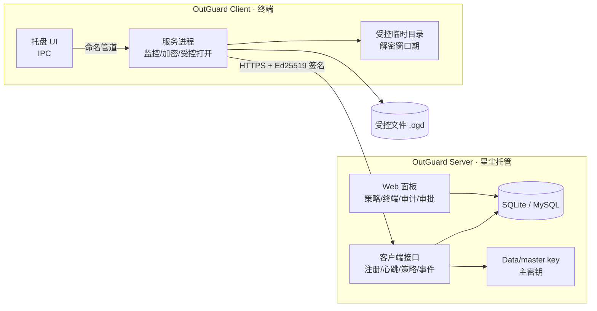
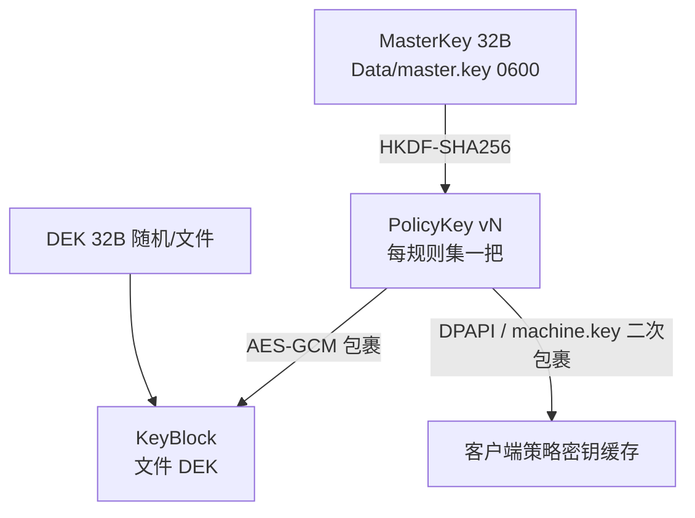
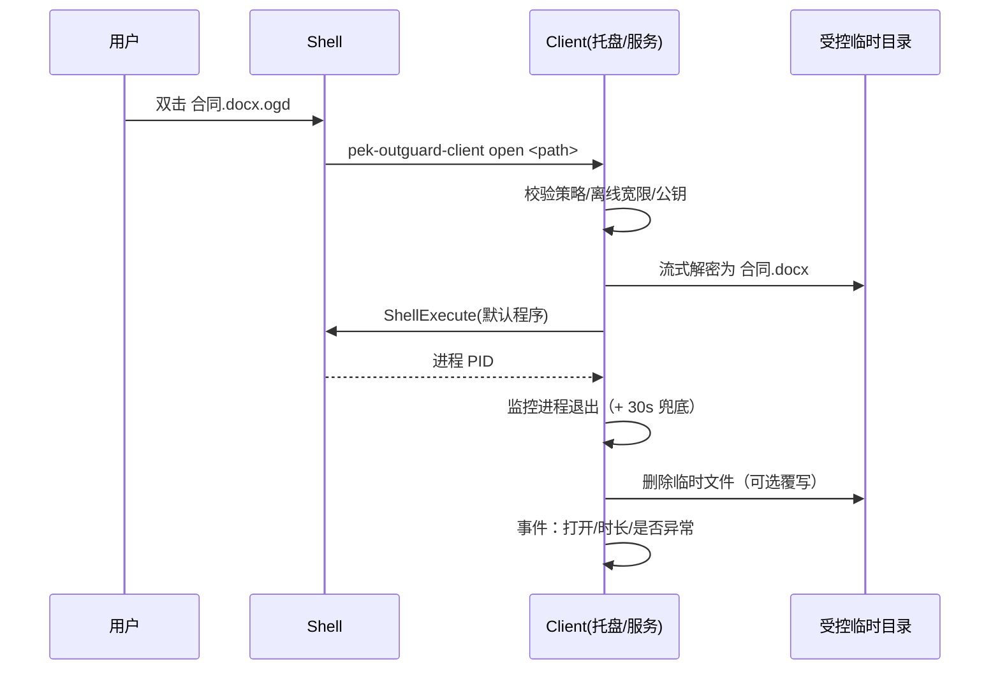

# Pek.ROutGuard 架构设计

> 版本：v0.1（2026-10-26）· 对应需求 `docs/需求说明书.md` v0.1
> 原则：**复用生态先行**（dhrust / Pek.RCode / Pek.RAdmin / Pek.RWaf），只写生态没有的 DLP 专有能力。

## 1. 总体拓扑



- **Server 单机部署**（与 Pek.RAgent / Pek.RPanlServer 生态一致），星尘托管影子模式运行。
- **Client 每终端一套**，Windows 服务 + 托盘。
- 两者只通过 HTTPS API 交互：客户端主动外联（无需服务端反连），适合内网/跨网段。

## 2. 代码结构（Cargo workspace）

```
core/     pek-outguard-core      容器格式 / 规则引擎 / 协议模型 / 密钥派生（双端共享，纯逻辑无 IO 副作用）
server/   pek-outguard-server    管理端 bin
client/   pek-outguard-client    终端 bin
```

**为什么 core 必须独立**：规则匹配与容器格式必须**双端同一份实现**，否则"服务端预览的判定结果"与"客户端实际执行"会漂移（Pek.RCode 的教训：消费方各自复制实现）。

## 3. 加密容器格式（v1）

`.ogd` 为唯一对外格式，**未装客户端只能看到明文头 + 密文**。

```
偏移        长度        内容
0           4          Magic  "OGD1"
4           2          formatVersion = 1
6           2          flags（bit0=头部是否加密，首版 0）
8           4          headerLen (u32 LE，≤ 64 KiB)
12          H          Header JSON（UTF-8，明文）
12+H        4          keyBlockLen (u32 LE)
16+H        K          KeyBlock：nonce(12) || AES-256-GCM(DEK)，AAD = SHA-256(Header JSON)
16+H+K      4          chunkSize (u32 LE，默认 1 MiB，上限 16 MiB)
20+H+K      8          noncePrefix（随机；分块 nonce = prefix(8) || 块序号 LE(4)）
28+H+K      4+N        [分块]：u32 LE 密文长度 + AES-256-GCM 密文（tag 附尾；每块 AAD 同上）
…           4          END 标记（u32 LE = 0；合法密文块长度 ≥ 16，故无歧义）
末尾        32         SHA-256（覆盖 END 之前的全部字节）
```

> **KeyBlock 必须前置**：解密要先拿到 DEK 才能流式解密；若放尾部就得把整份密文读完再回头解，4 GB 文件会多一次全量 IO。
> 明文头 + 明文 KeyBlock 都不含密钥材料，未装客户端用记事本即可看到公司提示语。

**Header JSON**（明文，满足"未装客户端也能看到防泄密提示"）：

```json
{
  "company": "XX有限公司",
  "notice": "本文件已加密，仅限安装 OutGuard 客户端的授权电脑打开。如需外发请联系信息安全部门。",
  "classification": "内部",
  "policyId": "…", "policyVersion": 12, "ruleId": "…",
  "creator": "zhangsan", "clientId": "…",
  "createdAt": "2026-10-26T10:00:00+08:00",
  "originalName": "合同.docx", "originalSize": 123456,
  "plainSha256": "…"
}
```

设计要点：
- **AAD = SHA-256(Header JSON)**：头部被篡改（改公司名/密级）会导致解密失败。
- 分块独立 GCM tag：支持流式加解密 + 断点续作，单块损坏不毁全文件。
- `originalName` 让客户端打开时按原名解密，避免 Office 关联失效。
- 明文头**不含任何密钥材料**，仅元数据 + 提示语。

## 4. 密钥体系



| 密钥 | 生成 | 存放 | 轮换 |
|---|---|---|---|
| MasterKey | Server 首启随机 32B | `Data/master.key`（0600，不入库不出网） | 支持备份/更换（旧密钥保留为 `master.key.v{n}`） |
| PolicyKey | `HKDF(MasterKey, "outguard/policy/{id}/v{n}")` 派生 | 不存明文；下发时用客户端公钥或 TLS 通道 + 本地包裹 | 提升 `key_version`，历史版本仍可派生 → 旧文件可解 |
| DEK | 每文件随机 | 仅存在于 KeyBlock（KEK 包裹） | 随文件 |
| 设备密钥对 | 客户端注册时生成 Ed25519 | 私钥客户端本地（DPAPI 保护），公钥登记服务端 | 重装即换新 |
| 客户端本地密钥 | Windows DPAPI / Linux `Data/machine.key`(0600) | 本地 | 随系统 |

**离线可用**：客户端缓存"包裹后的 PolicyKey"，断网也能加解密；宽限期只影响**打开**（可配），不影响已加密数据的可用性。

### 4.1 离线运行约定（断网照常保护）

| 环节 | 断网时 | 恢复联网后 |
|---|---|---|
| 规则判定 | 用 `Data/state.json` 缓存的规则集（含系统保护区与排除项） | 心跳比对版本 → 自动拉新策略并热生效 |
| 自动加密 | **照常加密**（策略密钥已缓存在本地，用令牌解包） | 不变 |
| 受控打开 / 解密 | 宽限期内正常；**超过 `OfflineGraceDays` 拒绝**（仍继续加密） | 恢复即可用 |
| 审计事件 | 进本地队列（≤5000 条，超限丢最旧） | 按 200 条/批自动补传，服务端按 `EventId` 幂等去重 |
| 未注册（首装断网） | 不崩溃，告警空转，每 60 s 重试注册 | 自动补注册 → 补同步 → 自动启用监控 |
| 监控根 | 用缓存策略的 `WatchRoots` | 每轮 `reconcile_watch` 与策略对齐（仅在变化时重建，不做周期全盘扫描） |

> 为什么超期只拒"打开"：加密是**保护**用户数据，断网时拒绝加密会导致明文外泄；解密是**放行**用户数据，长期离线必须收紧。这保证"拔网线"既不能绕过审计，也不会造成数据丢失。

## 4.2 透明打开路线（"无感"的三个档位）

用户的核心诉求是"装了客户端就该像普通文件一样用"。三种技术路线的体验与代价：

| 档位 | 方案 | 用户体验 | 代价 / 风险 | 状态 |
|---|---|---|---|---|
| **A1 受控打开** | 文件关联 + 解密到受控临时目录 + 编辑后自动回写 | 双击 `.ogd` 即开；**Office 内"文件→打开"仍看到 `.ogd`** | 无 | ✅ 已实现 |
| **A2 ProjFS 安全区** | 投影文件系统虚拟根（**纯用户态**，Win10 1809+/Server 2019+ 内置） | 安全区里就是 `合同.docx`，Word 直接打开保存，**近完全透明** | 无需驱动/签名；只对安全区生效；本机进程可读明文（拷走靠文件监控再加密） | 🚧 已接入探测与依赖，回调待实现 |
| **B 内核 minifilter** | 文件系统筛选驱动 | **完全透明**，全盘生效，拷到 U 盘仍是密文 | 需 WDK + EV 代码签名 + WHQL；蓝屏风险；与杀软/EDR 抢栈 | 暂不做（M3 可选） |

**为什么不上 HOOK（注入 Office 进程）**：现代 EDR 会拦截 DLL 注入，Office 有保护模式与沙箱，
且每个应用都要适配——投入产出比最差，不做。

**当前取舍**：先把 A1 做扎实（双击即开 + 保存自动回写 + 安全阀），A2 用 ProjFS 逐步推进，
B 留给有强合规要求的客户。

## 4.3 安全阀（默认不碰用户正式文件）

| 阀 | 默认值 | 作用 |
|---|---|---|
| `Mode` | `dry_run` | 只判定 + 记日志，**不加密/不移动/不删除任何文件**；切实盘需 `mode live --confirm` |
| `AllowRiskyRoots` | `false` | 桌面/文档/下载/用户目录本身/盘符根/系统目录 自动跳过并告警 |
| `RecoveryKeepDays` | `7` | 实盘时原文件移入 `Data/Recovery/<日期>/`，到期清理 |
| 写后校验 | 开 | 新容器必须能完整解密（分块 GCM + 尾部 SHA-256）才动原文件 |
| 服务端 `WatchRoots` | 空 | 未配置时客户端不监控任何目录 |

> 服务端下发的 `WatchRoots` 也要过同一道安全阀：即使服务端误配成 `C:\`，客户端也只告警并跳过。

## 5. 规则引擎（core::rules）

```rust
pub struct Rule {
    pub id: String,
    pub priority: i32,          // 数值大者优先
    pub action: Action,         // Encrypt | Plaintext | BlockWrite | Audit
    pub extensions: Vec<String>,// ["docx","xlsx","*"]，空=不限
    pub name_patterns: Vec<String>,
    pub path_prefixes: Vec<String>,
    pub process_names: Vec<String>, // ["winword.exe","wps.exe"]
    pub min_size: Option<u64>,
    pub max_size: Option<u64>,
}
```

判定顺序（**双端共用同一函数**）：

1. 系统/临时/缓存目录硬排除（内置）
2. 规则集绑定的 `exclude` 路径
3. 规则按 `priority` 降序、同级按声明顺序依次匹配
4. 都不命中 → 规则集 `default_action`（默认 `Plaintext`）
5. 结果 = `(action, matched_rule_id)`，写入容器头与审计

输入结构 `FileContext { path, size, process_name, user }`——服务端"规则预览"与客户端"实际执行"用同一输入模型。

## 5.1 系统保护区（不影响系统文件 · 硬约束）

**目标**：客户端在任何配置下都不能破坏操作系统与程序运行。这是产品红线，优先级高于"加密全覆盖"。

三级判定（`core::rules`，双端同一份）：

| 级别 | 范围 | 规则能否覆盖 | 审计标识 |
|---|---|---|---|
| **硬保护** | `\Windows\`、`\WINNT\`、`\Program Files\`、`\Program Files (x86)\`、`\$Recycle.Bin\`、`\System Volume Information\`、`\Config.Msi\`、`\Documents and Settings\`；盘符根的 `X:\boot\`、`\efi\`、`\recovery\`、`\perflogs\`、`\$WinREAgent\`；系统文件 `pagefile.sys`、`hiberfil.sys`、`swapfile.sys`、`dumpstack.log.tmp`、`ntuser.dat`、`ntuser.ini`、`bootmgr`、`bootnxt` | ❌ **永远不能** | `builtin:system` |
| **软排除** | `\AppData\Local\Temp\`、`\AppData\Local\Microsoft\Windows\`、`\AppData\Local\Packages\`、`\AppData\Local\CrashDumps\`、`.git/`、`.svn/`、`.hg/`、`node_modules/`、`__pycache__/`、`.vs/` | ❌ 在规则之前放行（防通用扩展名规则误加密） | `builtin:default-exclude` |
| **规则集排除** | 管理员配置的 `exclude_paths`（受控临时目录、共享盘等） | ✅ 可改配置 | `policy:exclude` |

设计要点：
- **不绑定盘符**：Windows 可装在 `D:`；按目录段匹配而不是 `C:\` 前缀。
- **盘符根才生效**：`X:\boot\` 是系统目录，`D:\Work\boot\` 是业务目录（不误伤）；UNC 共享盘不按此规则。
- **ProgramData 不进内置软排除**：它常放业务数据，由显式路径规则决定（有测试守住）。
- **服务端双保险**：配置 `watch_roots` 时用 `is_hard_protected` 校验，落在硬保护区直接拒绝/裁剪。

## 5.2 Windows 版本支持矩阵（A 级用户态）

| 系统 | 支持级别 | 说明 |
|---|---|---|
| Windows 11 21H2+ | ✅ 主线 | |
| Windows 10 1809+ | ✅ 主线 | |
| Windows 8.1 / 7 SP1 | ⚠️ 尽力 | 微软已 EOL；仅在存在存量客户时验证 |
| Windows Server 2025 / 2022 / 2019 / 2016 | ✅ 主线 | |
| Server 2012 R2 / 2012 | ⚠️ 尽力 | 同上 |
| Server Core（无桌面） | ✅ 服务模式 | 无托盘；安装与管理走 CLI/面板 |

A 级只依赖 XP 起就稳定的用户态 API（`ReadDirectoryChangesW`、DPAPI、命名管道、`ShellExecute`），**不装驱动、不注入进程、不改系统 DLL/关键注册表**——这是"不影响系统"的根本保证；B 级（minifilter）在每个 Windows 版本/补丁上都要单独验证内核行为，这正是首版不选它的原因之一。

## 5.3 与安全软件共存（部署必读）

- **Windows Defender 勒索软件防护会误报**：大量文件被重命名 + 内容变密文 = 典型勒索特征。必须把客户端进程与受控目录加入 Defender 排除项（组策略下发），并控制单批加密速率。
- **受控文件夹访问（CFA）** 会阻止写入文档目录：部署时关闭或加入白名单。
- 第三方杀软对"文件系统高频写入"敏感：上线前做白名单报备。

## 5.4 设备唯一码（MachineId）与人员绑定

**机器码** = `hex(SHA-256("outguard|uuid|guid|volume"))[..32]`（实现：`core::machine::machine_id`）

| 来源 | Windows 获取方式 | 稳定性 |
|---|---|---|
| SMBIOS UUID | WMI `Win32_ComputerSystemProduct.UUID` / `GetSystemFirmwareTable('RSMB')` | **重装不变**（主依据） |
| MachineGuid | `HKLM\SOFTWARE\Microsoft\Cryptography\MachineGuid` | 重装会变（兜底） |
| 系统盘卷序列号 | `GetVolumeInformationW` | 格式化会变（补充） |

- 归一化：去空白/连字符/大括号、转小写 → 格式差异不会改变机器码；
- 三者全空报错；只采到一项也能生成（保证可用性）；
- **虚拟机克隆**会得到相同 UUID → 面板提示"疑似克隆"，由管理员人工绑定；
- 有意**不加安装随机盐**（否则重装后无法识别同一台机器）。

**人员绑定**：`Og_StaffClient` 多对多（一台电脑多个使用人、一人多台电脑），终端面板可改绑定；面板登录用户（管理员/审批人/审计员）走 Pek.RAdmin，与员工档案分开存储。

## 6. 服务端模块

```
server/src/
  main.rs         CLI：run / install / uninstall / status / -RegisterAgent
  app.rs          装配：日志 → 配置 → 数据库 → 密钥 → 路由 → 监听
  db.rs           Pek.RCode store（Entity/Model.xml 生成）
  keys.rs         MasterKey 管理 + PolicyKey 派生 + 轮换
  policy.rs       规则集 CRUD / 绑定 / 版本推进 / 回执
  client_api.rs   /api/client/*（注册/心跳/策略/事件/审批/卸载令牌/升级）
  panel/          面板 API（复用 pek_radmin：用户/权限/审计）
  approvals.rs    外发审批
  upgrade.rs      客户端升级包（复用 dhrust::upgrade + patch）
  res/index.html  单文件面板（include_bytes!）
```

数据表（`Entity/Model.xml`）：

| 表 | 关键列 |
|---|---|
| `Og_Client` | ClientId、MachineId、Host、Os、OsBuild、Cpu、MemoryMb、DiskTotalGb、Domain、Ip、Mac、LoggedUser、Version、PolicyVersion、GroupId、DeptId、Status、InstalledAt、LastSeen、PubKey（资产台账 + 终端身份） |
| `Og_Department` | Id、Name、ParentId、LeaderId、Sort、Status（部门树） |
| `Og_Staff` | Id、Name、EmployeeNo、DepartmentId、Title、Phone、Email、Roles、Status、JoinedAt（人员档案；无密码，按终端上报的 Windows 用户名匹配） |
| `Og_StaffClient` | StaffId、ClientId、IsPrimary、BoundAt（人员 ↔ 终端 多对多，支持多人共用一台电脑） |
| `Og_Group` | Name、ParentId、Remark |
| `Og_ClientGroup` | ClientId、GroupId |
| `Og_PolicySet` | Name、Version、KeyVersion、DefaultAction、Enabled、CompanyInfo、Remark |
| `Og_PolicyRule` | PolicyId、Priority、Action、Conditions(JSON) |
| `Og_PolicyBinding` | PolicyId、TargetType(Group/Client/User)、TargetId、Priority |
| `Og_PolicyAck` | ClientId、PolicyId、Version、AckTime |
| `Og_ClientEvent` | ClientId、User、EventType、Path、RuleId、Detail、OccurredAt、ReceivedAt |
| `Og_Approval` | ClientId、User、Files(JSON：路径+哈希)、Reason、Receiver、Form、ValidHours、MaxOpens、Status、Approver、DecidedAt、RevokedAt |
| `Og_Envelope` | ApprovalId、EnvelopeHash、Size、CreatedAt、Revoked（外发包登记；见 `docs/外发审批与外发包设计.md`） |
| `Og_EnvelopeOpen` | EnvelopeId、MachineId、Ip、OpenedAt、Success、Detail（打开回执） |
| `Og_UninstallToken` | ClientId、Nonce、ExpireAt、Signature、Used |
| `Og_Setting` | Key、Value |

## 7. 客户端模块

```
client/src/
  main.rs        CLI：run / install / uninstall --token / status / open <file>
  service.rs     dhrust::service 注册与运行
  guard.rs       双进程互保 + 完整性自校验（60s）
  config.rs      Config/OutGuard.Client.toml（TomlConfig，服务端下发覆盖）
  enroll.rs      注册 + Ed25519 设备密钥（DPAPI）
  policy.rs      策略缓存（机器密钥包裹）+ 版本回执
  watcher.rs     notify crate（Windows ReadDirectoryChangesW / Linux inotify）+ 800ms 去抖
  engine.rs      调用 core::rules 判定
  crypto.rs      调用 core::container 流式加解密 + 原子替换 + 安全删除
  open.rs        受控打开：解密到 temp → ShellExecute → 进程退出 → 清理
  audit.rs       本地队列（SQLite/文件）+ 批量上报（5s / 200 条）+ 去重
  ipc.rs         命名管道（托盘 ↔ 服务）
  shell.rs       文件关联注册（`.ogd`）与双击入口
  ui/            托盘菜单与操作窗口（"申请解密/申请外发"入口，见外发设计 3.1）
```

**监控策略（性能红线）**：
- 只监控"规则可能命中的根路径"（由策略下发 `watch_roots`），不做全盘轮询。
- 事件去抖 800ms（Office 保存会连续产生多个写事件）；同一路径 2s 内只处理一次。
- 加密在**独立工作线程 + 有界队列**执行，不阻塞监控线程；大文件分块读写，内存占用 ≤ 8 MB。

**受控打开时序**：



## 8. 防退出设计（及边界）

| 层 | 手段 |
|---|---|
| 进程 | Windows 服务（LocalSystem）+ `SERVICE_CONFIG_FAILURE_ACTIONS` 自动重启 |
| 互保 | 独立 `guard` 进程（同 exe 不同参数）5s 检查服务，缺失则拉起；服务反向守护 guard |
| 权限 | 服务 ACL 限制 `SERVICE_STOP` 给 SYSTEM/Administrators；程序与配置目录 ACL 禁普通用户写 |
| 卸载 | `uninstall` 必须带服务端签发的 Ed25519 令牌（machineId + 过期时间 + nonce），客户端内置公钥验签；无令牌拒绝并上报 |
| 完整性 | 核心文件 SHA-256 清单内嵌；不匹配 → 上报 + 从备份恢复 |
| 升级 | 覆盖替换（影子模式），不需要用户停服 |

**边界（必须写进交付文档）**：本地管理员可用内核工具/PE 修改/重装系统绕过；本设计的目标是"合规管控 + 防普通用户误操作"，不是"对抗恶意管理员"。

## 9. 客户端接口（HTTPS + 签名）

所有请求头：

```
X-OG-Client: <clientId>
X-OG-Timestamp: <unix秒>
X-OG-Nonce: <随机16字节hex>
X-OG-Signature: base64(Ed25519(sign(method\npath\ntimestamp\nnonce\nsha256(body))))
```

| 方法 | 路径 | 说明 |
|---|---|---|
| POST | `/api/client/register` | 机器码 + 主机信息 + 公钥 + 注册码 → clientId / token / 状态 |
| POST | `/api/client/heartbeat` | 策略版本 + 健康状态 + **仅变化项** → 期望版本 / 指令 |
| GET | `/api/client/policy?version=N` | 拉取规则集 + 包裹后的 PolicyKey（304 语义：版本未变返回空） |
| POST | `/api/client/events` | 批量事件（≤200）→ accepted / duplicated |
| POST | `/api/client/approval` | 外发申请 |
| GET | `/api/client/approval/{id}` | 查询审批结果与授权令牌 |
| POST | `/api/client/envelope/register` | 登记本机生成的外发包（哈希/大小） |
| POST | `/api/envelope/open` | 查看器打开回执 + 吊销校验（公开接口，限流） |
| GET | `/api/client/upgrade?version=` | 升级包地址 + SHA-256 + 签名 |

服务端：`nonce` 5 分钟内存表防重放；`timestamp` 偏移 > 300s 拒绝；未注册客户端只能访问 `register`。

## 10. 部署与运维

- **Server**：`pek-outguard-server -RegisterAgent` 注册到星尘（Mode=11 影子模式、ReloadOnChange=true），覆盖程序文件即自动升级；`Config/OutGuard.toml` 热重载；`Data/master.key` 首次启动生成并提示备份。
- **WAF**：`pek_rwaf::admin_api()`；`/api/client` 前缀 `set_forced_skip_bot_prefixes`（客户端 UA `OutGuardClient/x.y` 会被误判为扫描器），攻击特征检测仍生效；**写 WAF 测试时 `loopback_bypass=false`**。
- **HTTPS**：无域名直连场景用自签叶子证书（`CA:FALSE` + SAN 全本机 IPv4）；有域名走反代 + 公共证书。
- **Client**：`msiexec /i OutGuardClient.msi /qn SERVER=https://host:5600 ENROLLCODE=xxx`（安装即注册）。
- **审计**：服务端事件表按月分表可选（Pek.RCode `timeShard`）；客户端本地队列上限 5 万条，超出丢弃最旧并记一条"队列溢出"事件。

## 11. 复用清单（新增能力必须在此登记理由）

| 能力 | 复用来源 |
|---|---|
| 日志 / 配置 / 原子替换 | `dhrust::logs` / `dhrust::config::TomlConfig` / `dhrust::io::safe_replace_file` |
| HTTP 服务 / 路由 / 静态资源 | `dhrust::net::http` + `router` + `static_files` |
| 面板鉴权 / 登录限流 | `dhrust::net::panel_auth` + `login_guard` |
| WAF | `pek_rwaf` |
| 服务化 / 星尘 / 升级 / 补丁 | `dhrust::service` / `staragent` / `upgrade` / `patch` |
| ORM / 数据库 / 备份 | `pek_rcode`（`database` + `store` + `db_admin`） |
| 面板用户 / 权限 / 审计 | `pek_radmin` |
| AES-256-GCM / 随机 / 签名 | `dhrust::secret` / `random` / `sign` |
| 进程名 / 系统信息 | `dhrust::sys::{process, monitor, machine}` |
| 限流 / 脱敏 | `dhrust::ratelimit` / `audit` |
| 文件系统事件监控 | **新增依赖 `notify`**（dhrust 无此能力；纯 Rust、Windows ReadDirectoryChangesW / Linux inotify、可交叉编译） |
| 容器格式 / 规则引擎 | **本仓 core 新写**（业务专属，无第二消费方） |

## 12. 关键取舍

1. **不引入内核驱动（M1）**：透明加密强度让位于可交付性；受控临时目录方案已能覆盖"防误发/防外带"主场景。
2. **客户端只执行不决策**：规则与密钥全部来自服务端，客户端篡改本地缓存无效（容器 AAD 绑定头部，密钥来自服务端）。
3. **心跳只发变化项**：与 Pek.RAgent 线上优化同口径（站点摘要 8 KB → 0.6 KB），1000 终端时带宽可忽略。
4. **审计批量上报**：5s 或 200 条，避免每个文件事件一次 HTTP。

## 13. 管理端形态：Web 面板 / Tauri 桌面外壳 / 单机版

### 13.1 结论：Tauri 做"外壳"，不做"服务本体"

| 形态 | 组成 | 适用 | 阶段 |
|---|---|---|---|
| **服务器版（主形态）** | `pek-outguard-server`（HTTP 服务，星尘托管）+ 同一套静态面板 | 多管理员/审批人、远程访问、无头服务器 | M1 |
| **桌面管理端（可选）** | `admin/`（Tauri 2 外壳）加载面板地址（本机或远程） | 管理员日常使用（托盘/通知/开机自启） | M2 |
| **单机版（按需）** | Tauri 外壳 + sidecar 本地服务 + SQLite | 小型企业/试点，无需独立服务器 | M3 |

**为什么不让 Tauri 承担服务本体**：

- 服务器常驻且无人登录时 Tauri 窗口无法渲染（星尘托管 / 服务化场景）；
- 多角色协作（审批人、审计员）需要浏览器/手机访问；
- 服务与 UI 同进程耦合后，UI 崩溃即服务不可用，升级也必须带着 UI 走。

**为什么仍值得做 Tauri 外壳**：

- 免"输地址进浏览器"，托盘常驻 + 新审批单通知；
- 单一安装包分发（含 WebView2 bootstrapper）；
- 面板是**同一份静态资源**，不重复开发。

### 13.2 外壳设计要点

- 目录：`admin/src-tauri/`（Rust 外壳），`frontendDist` 直接指向 `server/res`（面板只有一份副本）。
- 连接：默认 `http://127.0.0.1:5600`，支持配置远程服务器地址与多服务器切换。
- 能力：托盘（显示/隐藏/打开浏览器）、开机自启、审批待办通知（轮询 `/api/approvals/pending/count`）、可选自动更新。
- **不依赖 Tauri IPC**：面板保持纯 HTTP → 随时可退回浏览器，不被外壳绑架。

### 13.3 依赖与分发注意

- Windows 用 WebView2：Win10 1803+ / Win11 自带；**Server 2016/2019 需预装 Evergreen Runtime**（安装包内置 bootstrapper）。
- 构建链：Tauri 2 构建期需 Node.js；产物 `.msi`/`.exe`，约 5–10 MB。
- 单机版 sidecar：把 `pek-outguard-server.exe` 作为 externalBin 打包，启动时若本地服务未运行则拉起。
