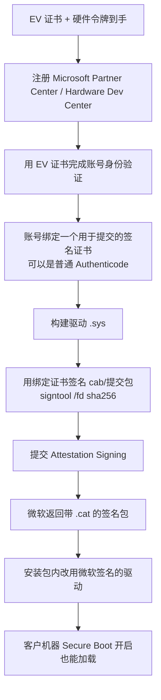

# 驱动签名：要求、采购与上线流程

> **结论先行**：正式交付给客户**必须**走微软 Dev Portal 签名，而注册该账号**必须**持有 EV 代码签名证书。
> 但 EV 证书**不是用来签驱动的**——它只是"门票"，真正的签名由微软做。
>
> 本文所有结论均已对照微软官方文档核实（2026-10-27），文末附出处。
> 采购与提交前请再核对一次官方页面，政策可能更新。

---

## 1. 为什么绕不过去

微软官方原文：

> **Starting with Windows 10, version 1607, Windows will not load any new kernel-mode drivers which are not signed by the Dev Portal.**
> Note that an **EV code signing certificate is required** to establish a dashboard account.

拆开就是三句话：

1. Win10 1607 之后，**Secure Boot 开启**的机器只加载「微软签发」的内核驱动；
2. 要让微软签，必须先有 Hardware Dev Center（Partner Center）账号；
3. 注册这个账号**必须用 EV 代码签名证书**做身份验证。

所以：**EV 证书 → 注册账号 → 提交 .sys → 微软签名 → 客户机器能加载**。少任何一环都不行。

---

## 2. 关键澄清：EV 证书 ≠ 能签驱动

这是最容易误解、也最容易白花钱的地方：

| 做法 | 结果 |
|---|---|
| 用 EV 证书直接 `signtool sign` 我们的 .sys | ❌ **在 Secure Boot 开启的 Win10/11 上照样加载失败**（`0xC0000428`） |
| EV 证书注册 Dev Portal → 提交 → 微软出一份 `.cat` 签名 | ✅ 这才有效 |

另一个官方细节（很多资料没提）：

> Although Microsoft strongly recommends that you sign individual submissions with an EV certificate,
> you can sign submissions with an **Authenticode signing certificate**. The Authenticode certificate must be
> registered to your Partner Center account.

意思是：**账号上绑一个 EV 证书**（满足注册要求）之后，每次提交时用于签包的证书**可以是普通 Authenticode 证书**。
所以不需要给每个开发/构建环境都配 EV 令牌——EV 只留在一个人手里做账号验证即可。

另：所有证书必须是 **SHA-2**，SignTool 用 `/fd sha256`。

---

## 3. 三种签名形态对照

| 形态 | 适用 | 是否需 HLK 测试 | 费用 | 用途 |
|---|---|---|---|---|
| **Attestation signing** | 仅 Win10/11 客户端 | **不需要** | 免费 | **我们要走这条** |
| **WHQL / WHCP 认证** | 需要微软 logo 认证、Server 全版本 | 要跑 HLK | 有测试与送审成本 | 本项目不需要 |
| **Test signing**（testsigning） | 开发自测 | 不需要 | 免费 | 开发期验证，**不能交付** |

**Attestation signing 不需要跑 HLK**，提交驱动包后微软自动签发，这就是本项目的最小路径。

---

## 4. 采购清单（EV 代码签名证书）

### 4.1 官方认可的证书颁发机构

微软文档明确列出这六家（其他家的证书可能无法通过账号验证）：

- Certum
- DigiCert
- GlobalSign
- IdenTrust
- Sectigo（原 Comodo）
- SSL.com

国内可经由上述厂商的授权代理购买；**务必确认所购证书类型是「EV Code Signing」**，不是 OV、不是 SSL。

### 4.2 需要准备的材料

| 材料 | 说明 |
|---|---|
| 企业营业执照 | 证书主体**必须是公司**，不能是个人 |
| 邓白氏编码（D-U-N-S） | **✅ 已具备（2026-10-27 确认）**，无需申请。采购时需向 CA 提供该号码 |
| 企业实际经营地址证明 | 部分 CA 会电话回访核实 |
| 申请人身份证明与授权 | 需公司出具授权 |
| 硬件令牌（USB Key） | CA 邮寄，证书私钥存在令牌里，**不可导出** |

### 4.3 预算与周期

| 项 | 数量级 |
|---|---|
| EV 代码签名证书 | 约 ¥3000~6000/年（不同 CA 与年限差异较大，请询价） |
| 硬件令牌邮寄 | 通常含在证书费用内 |
| 采购周期 | 材料齐全后 **1~3 周**（含令牌国际邮寄） |
| ~~邓白氏编码~~ | **已具备，不占周期**（原本是最长前置，现已消除） |

**结论：从"今天下单"到"拿到令牌"约 1~3 周**；之后注册验证 + 首次提交认定约 1 周内。
**到"客户机器可安装"的合计约 2~3 周。**

---

## 5. 上线流程（拿到证书之后）

**每次发版都要重走 E→G**（attestation 签名是逐次提交的，不是一次签永久）。

---

## 6. 例外方案（能不用 EV，但代价要看清）

微软文档列出的例外原文：

> Cross-signed drivers are still permitted if any of the following are true:
> - The PC was upgraded from an earlier release of Windows to Windows 10, version 1607.
> - **Secure Boot is off in the BIOS.**
> - Drivers was signed with an end-entity certificate issued prior to July 29th 2015 that chains to a supported cross-signed CA.

也就是说，**关掉 Secure Boot** 的机器可以加载由「受信任根 CA」签发的驱动。据此有三种替代：

| 方案 | 做法 | 代价 | 适用 |
|---|---|---|---|
| **A. testsigning** | 每台机 `bcdedit /set testsigning on` + 重启 | 桌面常驻"测试模式"水印；需关 Secure Boot；客户一眼看出不是正式产品；合规审计过不去 | 仅 PoC / 内部开发验证 |
| **B. 自建企业 CA + 关 Secure Boot** | 建根 CA、分发根证书到每台机、关闭 Secure Boot | **让客户关掉 Secure Boot 来装一个防泄漏产品**——说服力几乎为零，且确实降低整机安全性 | 极端封闭内网、客户安全负责人书面同意 |
| **C. 老证书交叉签名** | 需 2015-07-29 前签发的证书 | 现在已无法新申请 | 不可行 |

**判断口径**：这三种都只在"客户明确接受"的前提下成立。对外的商业交付，A/B 都属于"产品不完整"的交付形态。

---

## 7. 本项目的执行建议

### 7.1 立即启动（不占开发时间）

| # | 事项 | 负责 | 前置 |
|---|---|---|---|
| 1 | ~~查/申请邓白氏编码~~ | — | **✅ 已具备** |
| 2 | 向 Certum / DigiCert / GlobalSign / Sectigo 的代理询价 EV 代码签名证书 （询价时直接提供 D-U-N-S 号可加快核验） | 采购 | — |
| 3 | 确认申请人授权（证书主体必须是公司） | 管理层 | — |
| 4 | 下单并跟踪令牌邮寄 | 采购 | 2、3 |

### 7.2 与代码并行（不受证书影响）

- 驱动 M0~M2c 的加载验证：**testsigning + 自签名即可**，不需要 EV；
- 驱动侧真正加解密（M2d）：同上；
- 安装包、升级、卸载流程设计：先按"驱动由微软签名"的最终形态设计，开发期用自签名替换。

### 7.3 拿到证书后（预计 1~3 周后）

1. 注册 Partner Center 并用 EV 验证；
2. 绑定一个提交用的签名证书；
3. 首次提交 attestation signing，验证客户机器（Secure Boot 开启）能正常加载；
4. 把这条流程固化进打包脚本与发布清单。

### 7.4 交付前必须确认的两件事

- [ ] 客户机器的 **Secure Boot 是否开启**（决定是否必须微软签名）
- [ ] 客户是否接受"仅内网 + 关 Secure Boot + 企业 CA"的替代方案（若接受，可省证书成本，但需书面确认）

---

## 8. 需要写进安装包的说明

无论走哪条路线，安装包与部署文档都必须说清楚：

1. 驱动需要**重启**才能生效（minifilter 加载时机）；
2. 若使用 testsigning 形态，必须说明这是**非生产形态**，以及如何恢复正常模式；
3. **卸载驱动前必须先解密全部文件**，否则文件在无驱动环境下不可读（救援工具 `rescue decrypt` 是兜底）。

---

## 9. 官方出处

| 内容 | 链接 |
|---|---|
| 驱动签名策略（含例外条款原文） | https://learn.microsoft.com/en-us/windows-hardware/drivers/install/kernel-mode-code-signing-policy--windows-vista-and-later- |
| 驱动代码签名要求（EV 必要性、可用 CA 列表） | https://learn.microsoft.com/en-us/windows-hardware/drivers/dashboard/code-signing-reqs |
| 注册硬件开发计划 | https://learn.microsoft.com/en-us/windows-hardware/drivers/dashboard/hardware-program-register |
| Attestation signing 说明 | https://learn.microsoft.com/en-us/windows-hardware/drivers/dashboard/code-signing-attestation |
| Windows 10 驱动签名变更（背景） | https://techcommunity.microsoft.com/blog/windowshardwarecertification/driver-signing-changes-in-windows-10-version-1607/364894 |

---

*本文档随政策变化更新。最近一次核实：2026-10-27。*
